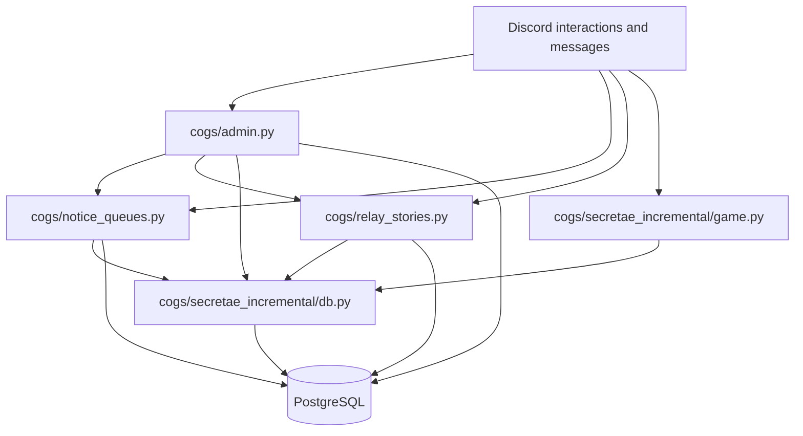

<a href="codebase.md"><kbd>English</kbd></a> <a href="codebase.ko.md"><kbd>한국어</kbd></a>

# 코드베이스 및 개발 안내

CommunityNoticeBot은 PostgreSQL을 사용하는 비동기 Python Discord 봇입니다.
현재 애플리케이션은 서버 관리, 예약 공지 대기열, 릴레이 이야기, 선택 기능인
Essence Foundry 게임을 제공합니다. 설정, 플레이어, 게임 월드 합계는 Discord
서버별로 독립 관리합니다.

## 처음 읽을 파일

[main.py](../main.py)에서 애플리케이션 구성을 확인한 뒤, 아래 모듈 표에서
수정하려는 기능을 찾아 읽으세요. 구성원이 보는 동작은
[관리자 명령어 참고](../admin_commands.ko.md)와
[게임 안내](secretae-incremental.ko.md)에서 설명합니다.

| 파일 또는 디렉터리 | 역할 |
| --- | --- |
| [main.py](../main.py) | 설정을 읽고 봇과 DB 풀을 생성하며, 마이그레이션·현지화 설정·활성 코그 로딩을 수행합니다. |
| [db.py](../db.py) | `asyncpg` 풀과 JSON/JSONB 코덱을 설정하고 스키마 초기화를 호출합니다. |
| [database/bootstrap.py](../database/bootstrap.py) | 스키마 초기화 및 기존 데이터의 버전별 수정 순서를 관리합니다. |
| [database/schema_bootstrap.py](../database/schema_bootstrap.py) | 커뮤니티 및 레거시 스키마 그룹을 초기화합니다. |
| [database/community_schema.py](../database/community_schema.py) | 서버 설정, 대기열, 릴레이, 길드 게임 상태, 보상, 감사 테이블을 정의합니다. |
| [database/legacy_schema.py](../database/legacy_schema.py), [database/incremental_schema.py](../database/incremental_schema.py) | 호환성과 마이그레이션에 필요한 기존 테이블을 유지합니다. |
| [cogs/admin.py](../cogs/admin.py) | `/admin` 명령을 선언하고 권한을 확인하며 기능 설정·검수·감사를 조율합니다. |
| [cogs/admin_support.py](../cogs/admin_support.py) | 서버 설정 조회 및 실행자만 사용할 수 있는 확인창을 제공합니다. |
| [cogs/notice_queues.py](../cogs/notice_queues.py) | 신청 기록, 대기열 정책, 게시 일정, Discord 게시, 보상 처리를 담당합니다. |
| [cogs/relay_stories.py](../cogs/relay_stories.py) | 이야기 기여와 작성 규칙을 관리하고, 보상 및 삭제에 따른 조정 기록을 처리합니다. |
| [cogs/game_config.py](../cogs/game_config.py) | 보상 정책을 검증하고 게임 활성 상태와 표시 이름을 결정합니다. |
| [cogs/localization.py](../cogs/localization.py) | 실행 중 메시지 카탈로그, 언어 선택, Discord 명령 메타데이터 번역을 관리합니다. |
| [messages/en.yml](../messages/en.yml), [messages/ko.yml](../messages/ko.yml) | 동일한 키와 자리표시자를 갖는 두 언어의 실행 중 메시지를 저장합니다. |
| [cogs/general.py](../cogs/general.py) | 최소한의 공통 Discord 이벤트 코그입니다. |
| `cogs/secretae_incremental/` | 현재 게임의 Discord 인터페이스, 계산, 저장, 마이그레이션을 구현합니다. |
| `tests/` | 숫자 계산, 게임 균형, 커뮤니티 정책, 현지화, 문서를 검사합니다. |
| `legacy/`, `cogs/submission_management/` | 이전 게임 및 신청 구현을 보관합니다. 호환 진입점 `cogs/tomak_management.py`, `cogs/kyohoon_management.py`는 후자의 구현에 위임합니다. 현재 `main.py`는 이 코그들을 로드하지 않습니다. |

## 시작 순서

1. `main()`이 `.env` 설정을 읽고 `DISCORD_TOKEN`을 확인합니다.
2. 메시지 내용 인텐트를 활성화한 Discord 봇을 만듭니다.
3. `init_pool(DATABASE_URL)`이 PostgreSQL 풀과 JSON 코덱을 설정합니다.
4. 기능 코드가 테이블을 조회하기 전에 스키마 그룹과 기존 데이터 수정 작업을 실행합니다.
5. `CommandTranslator`를 설치하고 `run_pending_migrations()`로 일회성 기존 게임
   마이그레이션을 실행합니다.
6. `general`, `admin`, `notice_queues`, `relay_stories`, `secretae_incremental.game`을
   로드한 뒤 Discord에 연결합니다.

코그의 준비 이벤트에서 명령을 등록하고 설정된 기존 커뮤니티 기능을 가져옵니다.
게임의 준비 이벤트는 기존 게임을 지정된 기존 서버로 가져오는 작업도 수행합니다.
기존 배포의 데이터베이스를 사용하기 전에
[마이그레이션 및 복구 안내](migration-recovery.ko.md)를 읽으세요.

## 기능 및 데이터 흐름



**공지 게시:** 리스너가 적격 신청을 기록하고, 예약 작업 또는 관리자가 대기열 정책에
따라 신청을 선택합니다. `publish()`는 DB 트랜잭션 안에서 신청을 잠그고 선택 상태로
기록한 뒤 Discord API로 게시물을 생성합니다. 생성된 채널·스레드 ID와 게시 상태를
저장한 다음 선택적인 게임 보상과 알림을 처리합니다. 선택, 게시, 보상 상태를 나눠
중단된 작업을 확인할 수 있게 합니다. PostgreSQL 트랜잭션으로 Discord 네트워크 호출을
원자적으로 처리할 수는 없으므로, 이 흐름을 바꿀 때 복구 동작을 명확히 유지해야 합니다.

**릴레이 기여:** 리스너가 이야기를 찾고 작성 규칙을 검증한 뒤 메시지 ID로 기여를
기록합니다. 활성화된 게임 보상은 별도로 지급합니다. 기여가 삭제되면 플레이어 진행도를
조용히 바꾸는 대신 보상 조정 사례를 만들 수 있습니다.

**게임 명령:** 코그가 언어를 결정하고 Discord 요청을 검증한 뒤 게임 DB 모듈의
트랜잭션 작업에 위임합니다. 해당 작업은 서버·플레이어 상태를 조회하고 잠근 뒤 변화를
계산해 저장합니다. 그다음 코그가 구성원에게 보여 줄 응답을 만듭니다.

## 게임 내부 구성

| 모듈 | 역할 |
| --- | --- |
| [game.py](../cogs/secretae_incremental/game.py) | `/game` 선언, 결과 표시, 농축 확인, 알림 설정 및 예약 알림을 담당합니다. |
| [db.py](../cogs/secretae_incremental/db.py) | 게임 트랜잭션, 생산·합성 계산, 농축, 보상 원장, 스냅샷, 조정을 담당합니다. |
| [numbers.py](../cogs/secretae_incremental/numbers.py) | 매우 큰 자원을 위한 `LayeredDecimal` 계산, 파싱, 표시, JSON 인코딩을 구현합니다. |
| [constants.py](../cogs/secretae_incremental/constants.py) | 자원 키, 표시 기호, 생산·합성 순서, 초기 수량을 정의합니다. |
| [simulation.py](../cogs/secretae_incremental/simulation.py) | 실제 명령과 같은 계산 함수로 결정적인 생산·합성 경로를 실행합니다. |
| [migration.py](../cogs/secretae_incremental/migration.py) | 기존 게임 데이터를 변환하고 마이그레이션 근거를 보존합니다. |

순수 함수 `production_step()`, `max_synthesis_step()`, `community_reward_step()`은
DB나 Discord에 접근하지 않고 메모리의 상태를 변경합니다. 시뮬레이션은 이 함수들을
재사용하여 명령과 균형 계산이 일치하도록 합니다. `LayeredDecimal`은 `sign`, `layer`,
`mag` 필드로 직렬화합니다. 자원을 부동소수점 수로 변환하지 말고 제공된 변환 메서드를
사용하세요.

## 데이터베이스 소유 범위

| 테이블 | 용도 |
| --- | --- |
| `guild_settings` | 서버 언어, 관리자·검수 정책, 감사 대상, 게임 설정입니다. |
| `notice_queues`, `notice_submissions`, `notice_jobs` | 대기열 정책, 신청·게시 상태, 예약 작업입니다. |
| `relay_stories`, `relay_contributions` | 이야기 설정과 기여·보상 상태입니다. |
| `guild_game_*` | 현재 서버·플레이어 자원, 월드 상태, 알림, 릴레이 보상 상태입니다. |
| `game_reward_ledger`, `game_state_snapshots`, `reward_reconciliation_cases` | 보상 식별 정보, 지급 전 플레이어 스냅샷, 검토한 조정 기록입니다. |
| `admin_audit_log`, `game_migration_evidence` | 관리자 작업과 마이그레이션 근거입니다. |
| `sc_*`, `si_*`, 기존 신청 테이블 | 마이그레이션에서 사용하는 기존 상태와 호환성 근거입니다. |

현재 게임 상태를 바꿀 때 `guild_id` 소유 범위를 명확히 유지하세요. 보상 유일성, 행 잠금
순서, 감사 기록을 보존해야 합니다. 스냅샷 복구는 저장된 플레이어 상태 전체를 복원하므로
보상 이후의 진행도도 영향을 받습니다.

## 로컬 개발

가상 환경을 만들고 실행 의존성을 설치합니다.

```sh
python3 -m venv .venv
source .venv/bin/activate
python3 -m pip install -r requirements.txt
```

환경 변수 또는 Git에 추가하지 않는 `.env` 파일에 `DISCORD_TOKEN`, `DATABASE_URL`을
설정합니다. 개발용 봇과 PostgreSQL DB를 사용하세요. Discord 봇 설정에서 Message
Content Intent를 켜고 `applications.commands` 범위로 초대한 뒤 테스트할 기능에 필요한
채널 권한을 부여합니다. 새 서버는 환경 변수의 서버·채널 ID 대신 관리자 설정 명령을
사용합니다. 기존 서버 가져오기 설정은
[마이그레이션 안내](migration-recovery.ko.md)에서 설명합니다.

```sh
python3 main.py
```

애플리케이션을 실행하면 지정된 DB를 초기화하고 마이그레이션합니다. 연결 후 서버 설정은
[시작 안내](getting-started.ko.md)를 따르세요.

## 변경할 때

- **명령 추가:** 해당 코그에서 이름·설명을 영어로 선언하고,
  `CommandTranslator._copy`에 한국어 메타데이터를 추가하며 두 언어의 명령 안내를
  함께 갱신합니다.
- **구성원 메시지 변경:** 두 YAML 카탈로그의 키와 자리표시자를 맞춥니다.
  [현지화 검토 절차](localization-review.ko.md)를 따르세요.
- **게임 정책 변경:** 순수 계산을 시뮬레이터와 공유하고 트랜잭션 공개 메서드를
  유지하며 관련 숫자 계산·균형 시나리오를 확인합니다.
- **스키마 변경:** 스키마·부트스트랩 모듈에서 작업하고 기존 데이터를 보존하며
  마이그레이션·복구 및 릴리스 안내를 따릅니다.

[코드 가독성 기준](../AGENTS.md)을 따르세요. 개발 검사에는 가상 환경에 Black을
설치한 뒤 다음 명령을 사용합니다.

```sh
python3 -m pip install black
python3 -m black --check main.py db.py cogs database tests
python3 -m compileall -q main.py db.py cogs database tests
python3 -m unittest discover -s tests -v
git diff --check
```

단위 테스트는 결정적인 상태, 고정 데이터, Discord·DB 대역을 사용합니다. 테스트 서버에서
권한, 일정, 명령 표시를 직접 확인하는 절차도 필요합니다.
[릴리스 점검표](release-checklist.ko.md)에서 해당 작업을 설명합니다.
