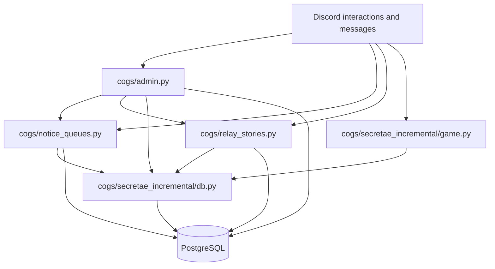

<a href="codebase.md"><kbd>English</kbd></a> <a href="codebase.ko.md"><kbd>한국어</kbd></a>

# Codebase and development guide

CommunityNoticeBot is an asynchronous Python Discord bot backed by PostgreSQL.
The active application combines server administration, scheduled notice queues,
relay stories, and the optional Essence Foundry game. Settings, players, and
game world totals belong to individual Discord servers.

## Start reading here

Start with [main.py](../main.py) to see how the application is assembled, then
follow the feature you want to change in the module map below. Read the
[administrator command reference](../admin_commands.md) and
[game guide](secretae-incremental.md) for the behavior members see.

| File or directory | Responsibility |
| --- | --- |
| [main.py](../main.py) | Loads configuration, builds the bot and database pool, runs migrations, installs localization, and loads active cogs. |
| [db.py](../db.py) | Creates the `asyncpg` pool, registers JSON/JSONB codecs, and invokes schema initialization. |
| [database/bootstrap.py](../database/bootstrap.py) | Orders schema initialization and versioned repairs to historical data. |
| [database/schema_bootstrap.py](../database/schema_bootstrap.py) | Initializes community and legacy schema groups. |
| [database/community_schema.py](../database/community_schema.py) | Defines server settings, queues, relay stories, guild game state, rewards, and audits. |
| [database/legacy_schema.py](../database/legacy_schema.py), [database/incremental_schema.py](../database/incremental_schema.py) | Maintain historical tables needed for compatibility and migration. |
| [cogs/admin.py](../cogs/admin.py) | Declares `/admin` commands, checks authority, and coordinates feature configuration, moderation, and audits. |
| [cogs/admin_support.py](../cogs/admin_support.py) | Provides server settings access and confirmation views restricted to the initiating member. |
| [cogs/notice_queues.py](../cogs/notice_queues.py) | Records submissions, applies queue policy, runs publication schedules, publishes to Discord, and coordinates rewards. |
| [cogs/relay_stories.py](../cogs/relay_stories.py) | Tracks story contributions, enforces contribution rules, coordinates rewards, and records removal cases. |
| [cogs/game_config.py](../cogs/game_config.py) | Validates reward policy and resolves game enablement and display names. |
| [cogs/localization.py](../cogs/localization.py) | Loads runtime message catalogs, resolves locales, and translates Discord command metadata. |
| [messages/en.yml](../messages/en.yml), [messages/ko.yml](../messages/ko.yml) | Store paired runtime messages with matching keys and format placeholders. |
| [cogs/general.py](../cogs/general.py) | Supplies the minimal shared Discord event cog. |
| `cogs/secretae_incremental/` | Implements the current game's Discord surface, arithmetic, persistence, and migration. |
| `tests/` | Covers arithmetic, game balance, community policy, localization, and documentation. |
| `legacy/`, `cogs/submission_management/` | Contain historical game and submission implementations. The compatibility entry points `cogs/tomak_management.py` and `cogs/kyohoon_management.py` delegate to the latter. These cogs are not loaded by the current `main.py`. |

## Startup sequence

1. `main()` loads `.env` configuration and requires `DISCORD_TOKEN`.
2. It creates a Discord bot with message content intent enabled.
3. `init_pool(DATABASE_URL)` creates the PostgreSQL pool and installs JSON codecs.
4. Database initialization creates the schema groups and applies historical
   repairs before feature code can query them.
5. The bot installs `CommandTranslator` and runs the one-time legacy game
   migration through `run_pending_migrations()`.
6. It loads `general`, `admin`, `notice_queues`, `relay_stories`, and
   `secretae_incremental.game`, then connects to Discord.

Cog readiness hooks register commands and import configured legacy community
features. The game's readiness hook also imports the old game into the configured
legacy server. Read the [migration and recovery guide](migration-recovery.md)
before using an existing deployment's database.

## Feature and data flow



**Notice publication:** a listener records an eligible submission. The scheduler
or an administrator selects it according to queue policy. `publish()` locks and
marks the submission as selected inside a database transaction, then calls
Discord to create the publication. It records the resulting channel/thread IDs
and published status before coordinating the optional game reward and member
notification. Selection, publication, and reward state are separate so operators
can inspect interrupted work. PostgreSQL transactions cannot make Discord
network calls atomic; keep recovery behavior explicit when changing this flow.

**Relay contribution:** the listener resolves the story, validates posting
rules, and records the contribution by message ID. If enabled, a game reward is
issued separately. Contribution removal can create a reward reconciliation case
instead of silently rewriting player progress.

**Game command:** the cog resolves locale and validates the Discord request,
then delegates to a transactional operation in the game database module. That
operation reads and locks server/player state, calculates the transition, and
persists it before the cog formats the member response.

## Game internals

| Module | Responsibility |
| --- | --- |
| [game.py](../cogs/secretae_incremental/game.py) | Declares `/game`, renders results, provides concentration confirmation and alert settings, and sends scheduled alerts. |
| [db.py](../cogs/secretae_incremental/db.py) | Owns game transactions, production and synthesis calculations, concentration, reward ledgers, snapshots, and reconciliation. |
| [numbers.py](../cogs/secretae_incremental/numbers.py) | Implements `LayeredDecimal` arithmetic, parsing, formatting, and JSON encoding for very large resources. |
| [constants.py](../cogs/secretae_incremental/constants.py) | Defines resource keys, display symbols, production/synthesis order, and initial balances. |
| [simulation.py](../cogs/secretae_incremental/simulation.py) | Runs deterministic production/synthesis routes using the same calculation functions as real commands. |
| [migration.py](../cogs/secretae_incremental/migration.py) | Converts historical game data and retains migration evidence. |

The pure functions `production_step()`, `max_synthesis_step()`, and
`community_reward_step()` mutate an in-memory state without database or Discord
access. Simulations reuse them to keep balance calculations consistent with
commands. `LayeredDecimal` values serialize as `sign`, `layer`, and `mag` fields;
use its conversion methods rather than converting balances to floats.

## Database ownership

| Tables | Purpose |
| --- | --- |
| `guild_settings` | Server language, administrator/moderator policies, audit destination, and game configuration. |
| `notice_queues`, `notice_submissions`, `notice_jobs` | Queue policy, submission/publication state, and scheduled work. |
| `relay_stories`, `relay_contributions` | Story configuration and contribution/reward state. |
| `guild_game_*` | Current server/player resources, world state, alerts, and relay reward state. |
| `game_reward_ledger`, `game_state_snapshots`, `reward_reconciliation_cases` | Reward identity, pre-reward player snapshots, and reviewed adjustments. |
| `admin_audit_log`, `game_migration_evidence` | Administrative and migration evidence. |
| `sc_*`, `si_*`, historical submission tables | Historical state and compatibility evidence used during migration. |

Keep `guild_id` ownership explicit when changing current game state. Preserve
reward uniqueness, row-lock ordering, and audit records. A snapshot rollback
restores the recipient's whole saved state, so later progress is also affected.

## Local development

Create a virtual environment and install the runtime dependencies:

```sh
python3 -m venv .venv
source .venv/bin/activate
python3 -m pip install -r requirements.txt
```

Configure `DISCORD_TOKEN` and `DATABASE_URL` in the environment or an untracked
`.env` file. Use a development bot and PostgreSQL database. Enable Message Content
Intent in the bot's Discord configuration, invite it with `applications.commands`,
and grant the channel permissions needed for the features you will exercise.
Fresh servers use administrator setup commands rather than server/channel IDs
in environment variables. Existing-server import configuration is documented in
the [migration guide](migration-recovery.md).

```sh
python3 main.py
```

Starting the application initializes and migrates the configured database; use
the [getting-started guide](getting-started.md) for server setup after connection.

## Making changes

- **Add a command:** declare English names/descriptions in the relevant cog,
  add Korean command metadata in `CommandTranslator._copy`, and update both
  language versions of the command guide.
- **Change member messages:** update both YAML catalogs with identical keys and
  placeholders. Follow the [localization review process](localization-review.md).
- **Change game policy:** keep pure calculations shared with the simulator,
  preserve the transactional public methods, and check the relevant arithmetic
  and balance scenarios.
- **Change schema:** use the schema/bootstrap modules, preserve existing data,
  and follow the migration/recovery and release guides.

Follow the [code readability standards](../AGENTS.md). For development checks,
install Black in the virtual environment and run:

```sh
python3 -m pip install black
python3 -m black --check main.py db.py cogs database tests
python3 -m compileall -q main.py db.py cogs database tests
python3 -m unittest discover -s tests -v
git diff --check
```

Unit tests use deterministic state, fixtures, and Discord/database substitutes;
they do not replace exercising permissions, schedules, and command rendering in
a test server. The [release checklist](release-checklist.md) describes that work.
